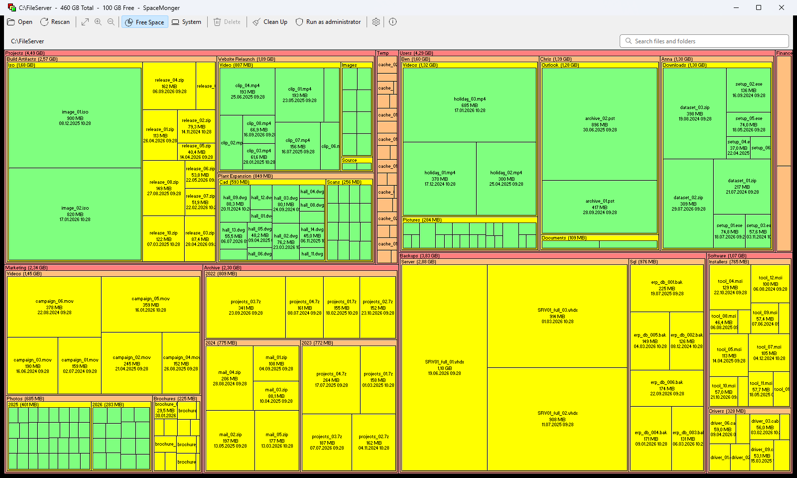
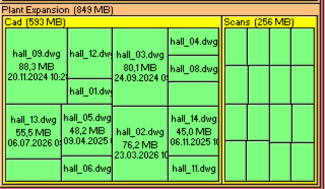
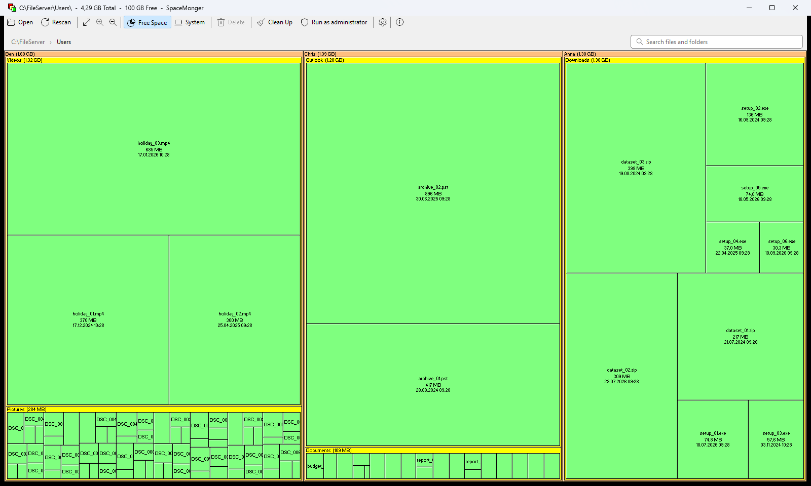
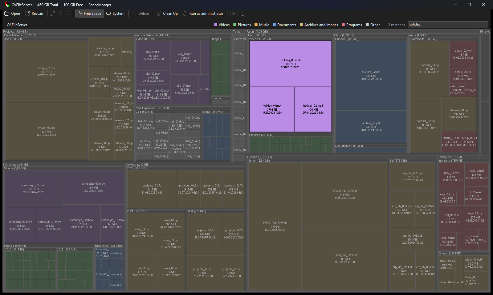
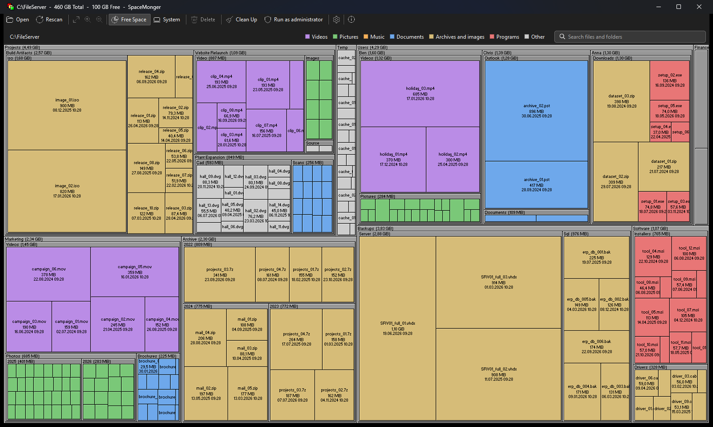
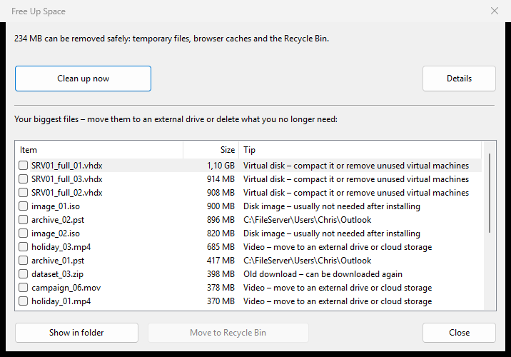
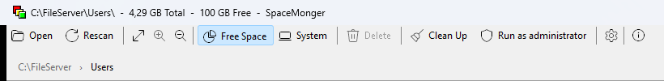
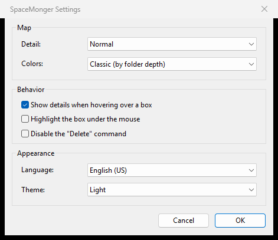

# SpaceMonger

[](https://github.com/JRpersonal/spacemonger/actions/workflows/build.yml)
[](https://github.com/JRpersonal/spacemonger/actions/workflows/codeql.yml)
[](https://scorecard.dev/viewer/?uri=github.com/JRpersonal/spacemonger)
[](https://github.com/JRpersonal/spacemonger/releases/latest)
[](https://github.com/JRpersonal/spacemonger/releases)
[](LICENSE.txt)

[](#download)
[](#download)
[](BUILDING.md)
[](SECURITY.md#verifying-a-download)
[](SECURITY.md#verifying-a-download)
[](https://github.com/Daduck/spacemonger)

[](https://github.com/sponsors/JRpersonal)
[](https://ko-fi.com/streborn)
[](https://paypal.me/JR31337)

**Drive full, and no idea why?** Windows tells you that space is running
out, but not where it went. Explorer shows no folder sizes, so you click
through folder after folder. SpaceMonger scans the drive in seconds and
draws every folder and file as a box, sized by the space it takes, with
name, size and date written on it. The big boxes are what fills your
drive: you see it at a glance, without opening a single folder.

What people use it for:

- **Free up a full drive.** Find the forgotten video, the old ISO image, the
  Outlook archive or the download folder nobody cleaned up, and move it to the
  Recycle Bin. Temporary files, caches and the Recycle Bin go in one click.
- **Decide before buying.** See whether you really need a bigger SSD, or just
  a cleanup, before you migrate a PC.
- **Help desk.** Look at a colleague's drive from your own desk over the admin
  share (`\\PC01\c$`), without installing anything on their PC.
- **File servers.** See which project, department or backup fills a share.
- **IT inventory.** Collect a CSV report from every PC on a share, run
  without a window from a logon script or a scheduled task.



## Download

| Windows | File |
|---|---|
| 64-bit (most PCs) | [SpaceMonger-x64.exe](https://github.com/JRpersonal/spacemonger/releases/latest/download/SpaceMonger-x64.exe) |
| ARM64 (Snapdragon, Surface Pro X) | [SpaceMonger-arm64.exe](https://github.com/JRpersonal/spacemonger/releases/latest/download/SpaceMonger-arm64.exe) |
| 32-bit (legacy) | [SpaceMonger-x86.exe](https://github.com/JRpersonal/spacemonger/releases/latest/download/SpaceMonger-x86.exe) |

One signed exe, no installer: save it anywhere and start it.
[How to verify a download](SECURITY.md#verifying-a-download).

## Features

All screenshots show a demo folder with placeholder files.

### See where the space is

Every box carries its name, size and date as long as it fits; folders show
their total in the title bar. Double-click a folder to zoom in, the path bar
above the map takes you back up.





- Scan a drive, a folder (*Open* > *Folder...*, or drop it on the window) or a
  network share.
- Zoom with a double-click, the mouse wheel or the keyboard; the path bar
  shows where you are, and each part of it is a link.
- Tooltips with full path, size, share of the drive, contents and date.
- On a whole drive, the free space is a block of its own, and Windows
  folders (Windows, Program Files, ...) are shown muted or can be hidden, so
  the eye goes to what you can change.

### Find things

Type into the search field (`Ctrl+F`): everything that does not match is
washed out, and the count of matches appears next to it.




### See what kind of files they are

*By file type* colours videos, pictures, music, documents, archives and disk
images, and programs, with a legend above the map. Dark mode follows Windows
or can be set in the settings.



### Free up space

*Clean Up* removes temporary files, browser caches and the Recycle Bin in one
click. Below, your biggest files are listed with a tip for each; tick what you
no longer need and move it to the Recycle Bin together.



- Nothing is ever selected for you, and deleting always goes to the Recycle
  Bin.
- *Show in Explorer*, *Properties* and *Delete* also work on any box in the
  map (right-click).

### For administrators

- Command line scans and headless CSV reports, see [Command line](#command-line).
- CSV export of the biggest folders and files from the window
  (right-click > *Export list*, `Ctrl+E`).
- *Run as administrator* restarts elevated with the same path, for folders
  the user cannot read.

### Looks like Windows today





- Fluent icons, light and dark mode, sharp text at any DPI and on mixed-DPI
  monitors.
- English, German and French, following the Windows display language.
- Colours by depth (the classic look), muted, Windows colours or by file type.

### Under the hood

- Multithreaded scanner; the map builds live while the scan runs.
- Unicode names and long paths end to end; junctions, symlinks, sparse files
  and cloud placeholders (OneDrive and others) are accounted for correctly.
- Honest numbers: a failed scan is an error, and space that could not be read
  shows up as *Unavailable (estimate)* instead of disappearing.
- Settings live in `HKCU\Software\65\SpaceMonger`; the program writes no other
  files than the reports and exports you ask for. No telemetry, no update
  checks.

Known limitation: hard links are counted once per link. Details in
[README.TXT](README.TXT).

## Why this fork

SpaceMonger has done one thing better than anything else since 1998: the
nested, labelled treemap. Pie charts and sorted lists show one level at a
time; SpaceMonger shows all of them at once, and the big boxes are where the
work is. That idea has aged well. The program around it had not: no
signature, no way to run it unattended, no answer for network shares, and a
look from Windows 98.

This fork keeps the idea and closes the gaps that stop it from being used in
a company:

| Need in a company | What this fork does |
|---|---|
| Software from the internet must be trustworthy | Authenticode-signed (Certum), `SHA256SUMS`, Sigstore build provenance, CodeQL and OpenSSF Scorecard |
| Nothing to install, nothing to clean up | One standalone exe for x64, ARM64 and x86; static MFC and runtime, no installer, no services, no telemetry or update checks |
| Help desk looks at a user's PC | Scan a remote PC over its admin share: `SpaceMonger.exe \\PC01\c$` |
| File servers and shares | Scan any folder or UNC path, drag and drop, *Run as administrator* for folders the user cannot read |
| Inventory across many PCs | Headless `/report`: no window, a CSV per computer to a share, exit codes for scripts |
| Numbers that hold up | Failed scans are errors, unreadable space is shown as *Unavailable (estimate)* instead of disappearing, junctions, symlinks and cloud placeholders are not counted twice |
| Users who are not technicians | Windows look, dark mode, German, English and French, system folders muted, *Clean Up* for safe space (temp, caches, Recycle Bin), everything else goes to the Recycle Bin |

The original treemap, its colours and its speed stay as they were.

## Command line

```text
SpaceMonger.exe [path] [/report <file or folder>] [/top N] [/hide-system]
```

| Example | |
|---|---|
| `SpaceMonger.exe D:\` | opens the window and scans D: right away |
| `SpaceMonger.exe \\PC01\c$` | an admin scans a remote PC over its admin share |
| `SpaceMonger.exe /report \\srv\reports\` | no window: scans the Windows drive, writes `\\srv\reports\<COMPUTER>_<yyyy-mm-dd>.csv` and exits |
| `SpaceMonger.exe \\PC01\c$ /report pc01.csv /top 50 /hide-system` | remote report with the 50 biggest folders and files, without system content |

Exit codes: `0` written, `1` invalid arguments (`/?` prints the usage to the
calling console), `2` scan failed, `3` report not written.

The report starts with drive size, used, free and *not readable* space, then
lists the largest folders and files. It is UTF-8 with the list separator of
the user's locale, so Excel opens it in columns. An excerpt (`/top 8`):

| Computer | Kind | Path | Size (GB) | Share (%) | Files | Modified | System |
|---|---|---|--:|--:|--:|---|---|
| PC-0142 | Folder size | `C:\FileServer\` | 18.79 | | 548 | | |
| PC-0142 | Folder | `C:\FileServer\Projects\` | 4.49 | 23.9 | 116 | 2026-10-24 | no |
| PC-0142 | Folder | `C:\FileServer\Users\` | 4.29 | 22.9 | 124 | 2026-10-24 | no |
| PC-0142 | Folder | `C:\FileServer\Backups\` | 3.83 | 20.4 | 9 | 2026-10-24 | no |
| PC-0142 | File | `C:\FileServer\Backups\Server\SRV01_full_01.vhdx` | 1.10 | 5.8 | | 2026-06-19 | no |
| PC-0142 | File | `C:\FileServer\Users\Chris\Outlook\archive_02.pst` | 0.87 | 4.7 | | 2025-06-30 | no |

The full file also has the size in bytes and the scan date.

### Rolling it out

- **Users:** copy the signed exe to a shared or local folder and give them a
  shortcut; with a path argument it skips the drive dialog.
- **Inventory:** run the `/report` line from a logon script, a scheduled task
  or your software deployment tool and collect the CSV files on a share.
  Run it elevated (or as SYSTEM) to include folders the user cannot read;
  without that, the space shows up as *Not readable*.
- **Help desk:** `SpaceMonger.exe \\PC01\c$` from an admin workstation shows
  the remote drive without installing anything on it.

## Documentation

| Topic | |
|---|---|
| [Architecture and current state](docs/ARCHITECTURE.md) | components, scan flow, dependencies, pipeline (with diagrams) |
| [Build and test](BUILDING.md) | Visual Studio 2022, CMake presets for x86/x64/ARM64 |
| [Releasing](docs/RELEASING.md) | signed release runbook, one-time setup, troubleshooting |
| [User guide](README.TXT) | usage, disk accounting, partial scans, version history |
| [Backlog and decisions](BACKLOG.md) | priorities, distribution and UI constraints |
| [Changelog](CHANGELOG.md) | release notes source |
| [Contributing](CONTRIBUTING.md) · [Code of Conduct](CODE_OF_CONDUCT.md) · [Security](SECURITY.md) | |

Historical implementation records:
[treemap design](docs/superpowers/specs/2026-08-15-treemap-layout-engine-design.md) /
[plan](docs/superpowers/plans/2026-08-15-treemap-layout-engine.md),
[live-scan design](docs/superpowers/specs/2026-08-15-live-progressive-treemap-scan-design.md) /
[plan](docs/superpowers/plans/2026-08-15-live-progressive-treemap-scan.md).
They describe the original work; implementation-status notes record later decisions.

## Support the project

SpaceMonger is free and funded by donations:
[GitHub Sponsors](https://github.com/sponsors/JRpersonal) ·
[Ko-fi](https://ko-fi.com/streborn) ·
[PayPal](https://paypal.me/JR31337).

## Open source

SpaceMonger is free software under the [MIT License](LICENSE.txt).

- **Original author:** Sean Werkema, SpaceMonger 1.0 to 1.4.0 (1998–2000),
  source published as [seanofw/spacemonger1](https://github.com/seanofw/spacemonger1).
- **Modernization:** Johnny J. Andersen, releases 1.4.1 to 1.4.4 at
  [Daduck/spacemonger](https://github.com/Daduck/spacemonger).
- **This fork:** Jens Roggenfelder, signed releases, production CI/CD and
  the changes for use in companies. Changes that are not fork-specific are
  offered upstream.

The executable statically links MFC and the MSVC runtime and has no other
dependencies. Licenses of everything involved are listed in
[THIRD-PARTY-NOTICES.md](THIRD-PARTY-NOTICES.md).
