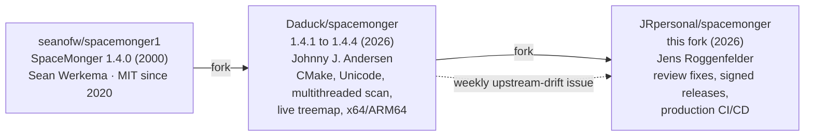
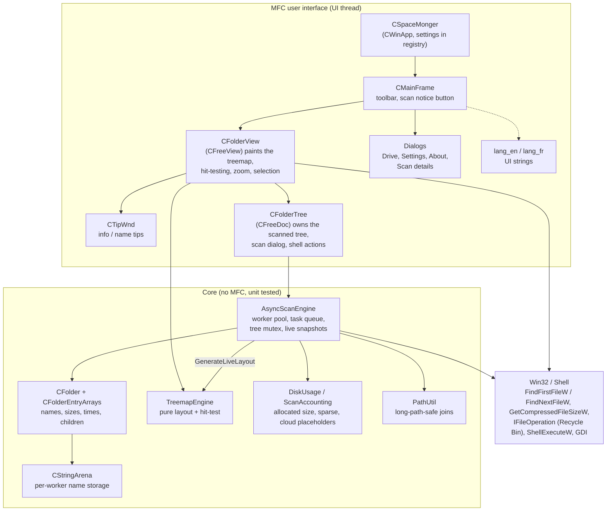
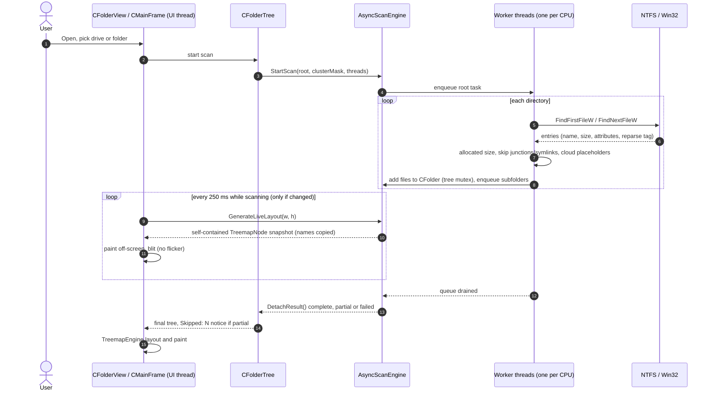
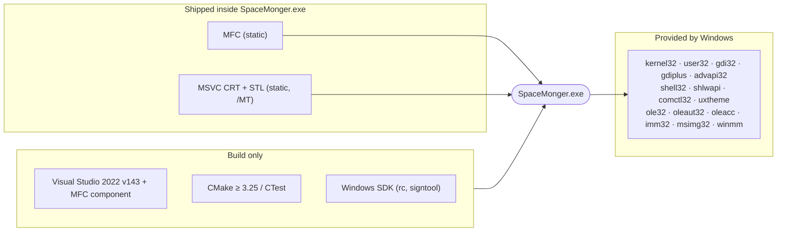
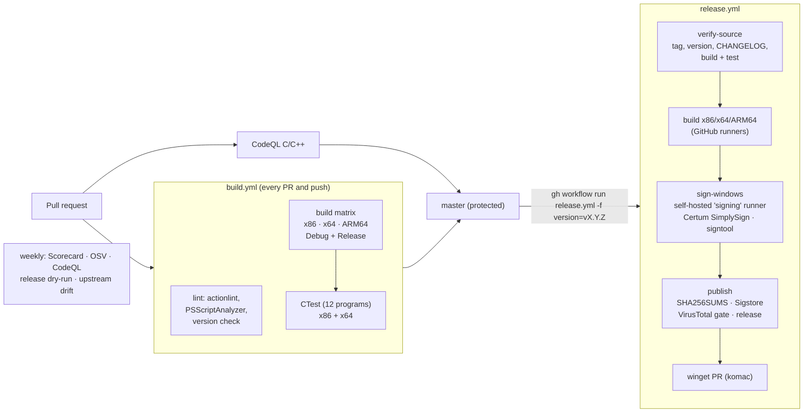

# SpaceMonger: architecture and current state

State of `master` on 2026-10-23, version **1.4.4** (next release from this
fork: 1.4.5). A short tour for anyone who wants to understand, build or ship
SpaceMonger.

## At a glance

| | |
|---|---|
| What | Native Windows disk-space visualizer: a treemap of a drive, folder sizes at a glance, zoom, open, delete to Recycle Bin |
| Language / UI | C++17, MFC (static), Win32 GDI, Unicode (`UNICODE`/`_UNICODE`) throughout |
| Targets | Windows 10/11/Server, x86, x64, ARM64; Per-Monitor V2 DPI aware, long paths |
| Distribution | One standalone `SpaceMonger-<arch>.exe` (≈2.7 MB x64), no installer, no runtime dependencies |
| Size of code | ≈6,500 lines in 47 source files, ≈2,200 lines in 13 test programs (CTest) |
| License | MIT, © Sean Werkema, Johnny J. Andersen, Jens Roggenfelder ([lineage](../THIRD-PARTY-NOTICES.md)) |

## Where it comes from



## What the user sees

```text
┌─ SpaceMonger - C:\ ───────────────────────────────────────────────┐
│ [Open][Zoom In][Zoom Out][Zoom Full][Run/Open][Delete][Setup]  Skipped: 3 │
├───────────────────────────────────────────────────────────────────┤
│┌ Windows ─────────────────────┐┌ Users ─────────────────────────┐│
││┌ System32 ────────┐┌ WinSxS ┐││┌ jens ────────────────────────┐││
│││ driverstore      ││        ││││┌ AppData ──────┐┌ Videos ───┐│││
│││                  ││        ││││ Local          ││ holiday.mp4││││
││└──────────────────┘└────────┘│││└───────────────┘└───────────┘│││
│└──────────────────────────────┘│└──────────────────────────────┘││
│┌ Program Files ──────┐┌ pagefile.sys ┐┌ Free space ────────────┐ │
│└─────────────────────┘└──────────────┘└────────────────────────┘ │
└───────────────────────────────────────────────────────────────────┘
  rectangle area ∝ bytes · nesting = folders · colour = depth
```

`Skipped: N` appears only for partial scans and opens the details dialog.
For a partial whole-drive scan an *Unavailable (estimate)* block covers
volume-used space that the scan could not account for.

## Components



| File(s) | Responsibility |
|---|---|
| `SpaceMonger.cpp/.h` | Application object, settings (`CCurrentSettings`), registry persistence |
| `Mainfrm.cpp/.h` | Main window, classic 3D toolbar, partial-scan notice |
| `FolderView.cpp/.h`, `Freeview.cpp`, `xapp.h` | Treemap window: double-buffered GDI painting, rollover, zoom, context menu |
| `FolderTree.cpp/.h`, `Freedoc.cpp` | Document: starts scans, receives the finished tree, shell actions |
| `AsyncScanEngine.cpp/.h` | Multithreaded scanner, cancellation, partial/failed outcomes, live layout snapshots |
| `Folder.cpp/.h`, `FolderEntryArrays.*`, `FolderSort.h`, `StringArena.h` | In-memory tree and its memory management |
| `TreemapLayout.cpp/.h` | Headless treemap layout and hit-testing |
| `DiskUsage.*`, `ScanAccounting.h`, `PathUtil.*` | Size accounting and path handling |
| `TipWnd*`, `UnicodeFontFallback.h` | Tooltips and font fallback for non-Latin names |
| `*Dialog*.cpp`, `SetupDlg.cpp` | Drive picker, settings, About, scan details |
| `CommandPolicy.h`, `ScanNotice.h` | Small pure policies (which commands are allowed, notice text) |
| `SpaceMonger.rc`, `res/` | Dialogs, version info, toolbar bitmaps, icon |
| `legacy/` | Original Visual C++ 6 project files (history only) |

## How a scan works



Design points worth knowing:

- **Live snapshots own their data.** `GenerateLiveLayout` copies names into the
  snapshot, so painting never touches the tree that workers are changing.
- **Lock cost was measured, not guessed**: on 2 million files the live
  layout cost ≈3 % throughput (`docs/LIVE_SCAN_BENCHMARK.md`, `BACKLOG.md`).
- **Honest results**: failed roots are errors; access-denied or >128-level
  subtrees make the result *partial* and are listed in the details dialog.
- **Hard links are counted per link** (known limitation, see `README.TXT`).

## Dependencies



No third-party libraries, no package manager, nothing downloaded at build or
run time. Licenses of everything involved, including the CI actions, are in
[THIRD-PARTY-NOTICES.md](../THIRD-PARTY-NOTICES.md).

## Build, test and release pipeline



Signing in detail, and what to do when it fails: [RELEASING.md](RELEASING.md).

## Quality gates

| Gate | Where | Blocks merge / release |
|---|---|---|
| Build x86/x64/ARM64, Debug + Release, `/W3` | `build.yml` | merge |
| 12 CTest programs (scanner incl. Unicode and access-denied fixtures, treemap, accounting, allocation failure) | `build.yml` | merge |
| CodeQL C/C++ | `codeql.yml` | merge |
| actionlint, PSScriptAnalyzer, version consistency | `build.yml` (lint) | merge |
| Version = tag, CHANGELOG entry, tag unused | `release.yml` verify-source | release |
| Authenticode signature present and valid | `release.yml` sign-windows / publish | release |
| VirusTotal broad detection (≥10 engines or ≥15 %) | `release.yml` publish | release |
| Published assets match `SHA256SUMS` | `release.yml` publish | release (post-check) |
| OpenSSF Scorecard, OSV-Scanner | weekly | report only |

Not automated: interactive checks of scan dialogs, mixed-DPI rendering and
shell operations, and ARM64 test execution (build only).

## Open points

From [BACKLOG.md](../BACKLOG.md): x64 conversion warnings in `DriveDialog.cpp`
and `Freedoc.cpp`, interactive verification of partial-scan dialogs and DPI,
incremental live-size propagation (deferred after benchmarking), contiguous
`CFolder` layout, dark mode, folder/UNC picker, filters.
