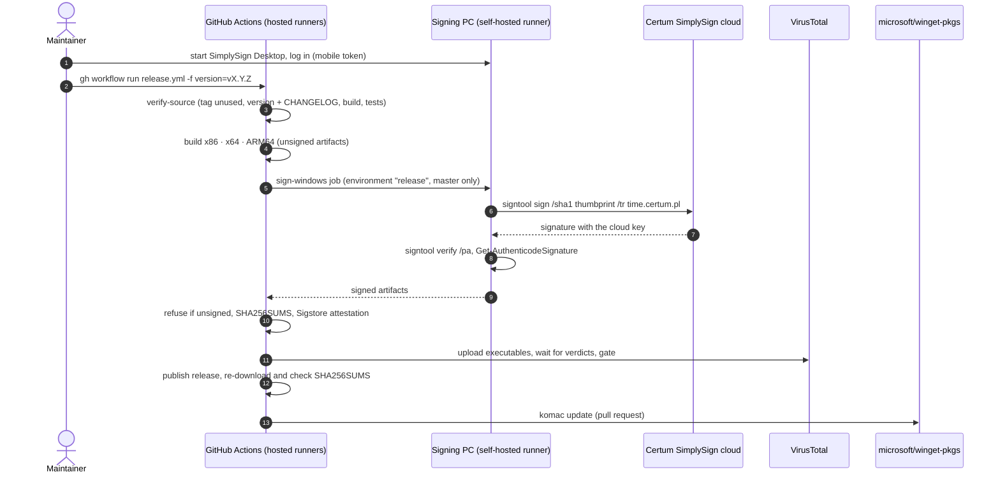

# Releasing SpaceMonger

Runbook for the maintainer. The pipeline is
[`.github/workflows/release.yml`](../.github/workflows/release.yml); the
overview diagram is in [ARCHITECTURE.md](ARCHITECTURE.md#build-test-and-release-pipeline).

## Cutting a release

1. **Bump the version** on a branch and open a pull request:
   ```powershell
   .\tools\version.ps1 -Set 1.4.5
   ```
   Rename `## [Unreleased]` in `CHANGELOG.md` to `## [1.4.5] - YYYY-MM-DD`
   (and add a new empty `## [Unreleased]` above it), and add a
   `Between 1.4.4 and 1.4.5` entry to `README.TXT`. Merge once CI is green.
2. **Open the signing session** on the signing PC: start the runner
   (`C:\actions-runner-spacemonger\run.cmd`, unless it runs already) and
   **SimplySign Desktop**, then log in with the token from the SimplySign
   mobile app. The session times out after a while of inactivity, so do this
   right before step 3.
3. **Start the release**:
   ```powershell
   gh workflow run release.yml -R JRpersonal/spacemonger -f version=v1.4.5
   gh run watch -R JRpersonal/spacemonger
   ```
   Pre-release: `-f version=v1.4.5-rc.1 -f prerelease=true` (no winget, not
   "latest").
4. **Check the result**: release page, `SHA256SUMS`, VirusTotal links in the
   notes, and on a Windows PC:
   ```powershell
   Get-AuthenticodeSignature .\SpaceMonger-x64.exe | Format-List Status, SignerCertificate
   gh attestation verify .\SpaceMonger-x64.exe --repo JRpersonal/spacemonger
   ```
5. **winget**: komac opens a pull request in `microsoft/winget-pkgs`; the
   winget maintainers merge it, usually within a few days.

A run without `version` (or the Sunday schedule) is a **dry-run**: build,
tests, hashes and attestation, no signing, no publishing.

## What happens where



## One-time setup (done on 2026-10-23, keep for reference)

| Item | Where | Value / note |
|---|---|---|
| Variable `CERT_THUMBPRINT` | repo Settings > Secrets and variables > Actions > Variables | `A797BE1F0A11B06B9B0E55C7827F6B8214DBB95E` (Certum Open Source cert, valid to 2027-07-25). Not secret: it is in every signed file |
| Environment `release` | repo Settings > Environments | deployment branches: `master` only. Only `sign-windows` uses it |
| Self-hosted runner | `C:\actions-runner-spacemonger` on the signing PC | name `jens-pc-signing-spacemonger`, labels `self-hosted, Windows, X64, signing`. Separate from the streborn runner in `C:\actions-runner`: runners of a personal account belong to one repository |
| Secret `VT_API_KEY` | repo secret | VirusTotal API key (same as streborn). Optional; without it the scan is skipped |
| Secret `WINGET_TOKEN` | repo secret | classic PAT, scope `public_repo` (same as streborn). Optional |
| Secret `RELEASE_PUBLISH_PAT` | repo secret | fine-grained PAT for this repo, Contents read/write. Optional; avoids a failure when `master` moves during a release |
| Fork pull request workflows | Settings > Actions > General | approval required for all outside contributors |

Set the secrets from a terminal (paste the value when asked):

```powershell
gh secret set VT_API_KEY -R JRpersonal/spacemonger
gh secret set WINGET_TOKEN -R JRpersonal/spacemonger
gh secret set RELEASE_PUBLISH_PAT -R JRpersonal/spacemonger
```

## Troubleshooting

| Symptom | Cause and fix |
|---|---|
| `sign-windows` stays *Queued* | Signing runner offline. Start `C:\actions-runner-spacemonger\run.cmd` (or the service). The job waits up to 24 h |
| `SimplySign Desktop is not running` / `Certificate ... is not in Cert:\CurrentUser\My` | Start SimplySign Desktop and log in; the virtual card is only mounted during a session. Then *Re-run failed jobs* |
| `signtool sign failed` after 3 attempts | Timestamp server `time.certum.pl` unreachable or session expired. Log in again, re-run |
| `Refusing to publish unsigned executables` | Signing was skipped or failed on a real release. Check `vars.CERT_THUMBPRINT`, runner and session, then re-run the whole workflow |
| `tag vX.Y.Z already exists` | Version not bumped. Run `tools\version.ps1 -Set` on a branch |
| `Release tag ... does not match the source version` | Tag and `CMakeLists.txt`/`.rc` disagree. Bump with `tools\version.ps1` |
| VirusTotal gate failed | Read the engine list in the log. False positive: report it to the vendor, then re-run. Do not lower the threshold casually |
| winget step failed | Does not affect the release. Submit that version by hand with komac (`packaging/README.md`) |
| Certificate expires (2027-07-25) | Renew the Certum Open Source certificate, update `CERT_THUMBPRINT`. Already signed releases stay valid thanks to the timestamp |
